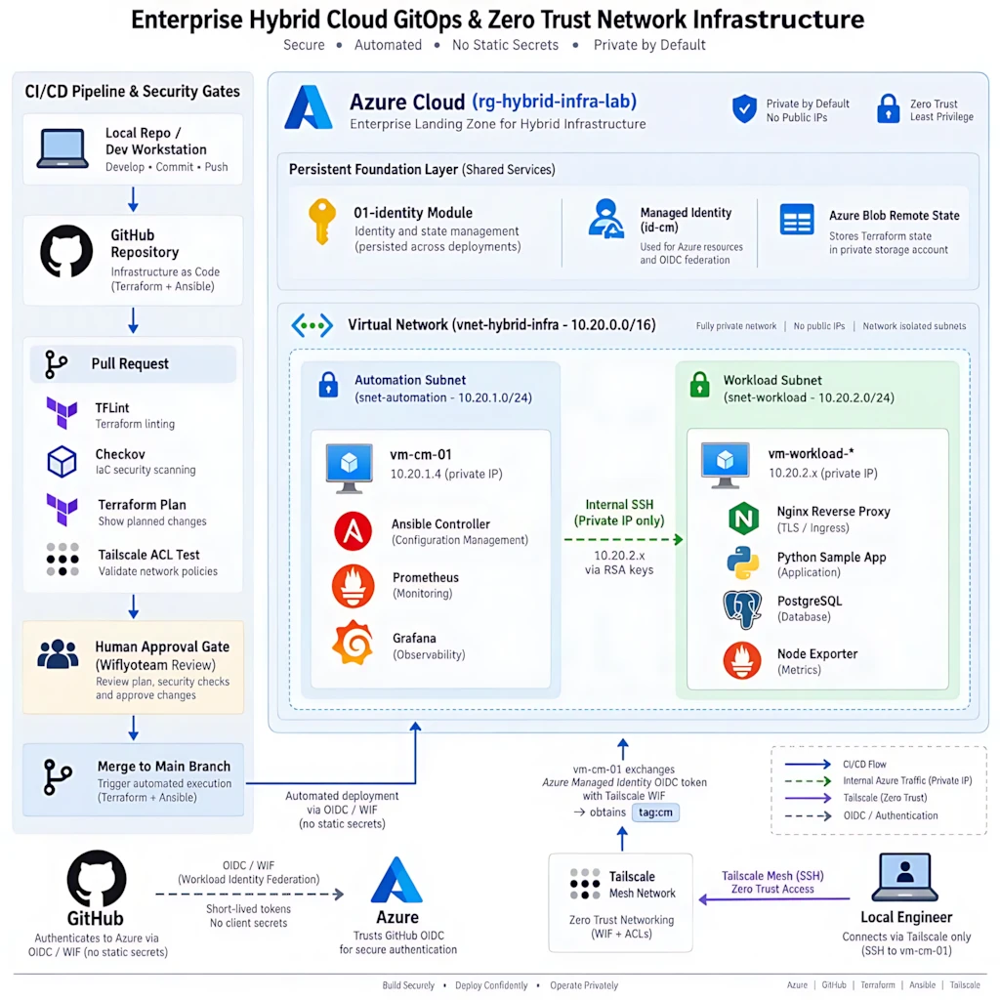

# 🚀 Hybrid Infrastructure Lab (Terraform, Azure, Ansible, GitHub OIDC & Tailscale)

Welcome to the **Hybrid Infrastructure Lab**!

This repository provides a complete, hands-on blueprint for building a **Zero-Trust, highly secure, and automated hybrid network**. It bridges public cloud resources (Azure) with automated configuration management (Ansible) and modern identity controls (GitHub OIDC & Tailscale Mesh).

---

## 🎯 Why This Lab? (Business & Engineering Benefits)

In traditional infrastructure management, engineering teams often face major challenges:
* ❌ **Security Risks:** Public IPs on internal servers, open SSH ports, and hardcoded passwords or API keys stored in CI/CD variables.
* ❌ **High Operational Costs:** Wasted cloud budget from unoptimized resources and manual setup errors.
* ❌ **Configuration Drift:** Systems configured manually without logs, making it hard to trace who changed what when things break.

### Key Benefits of This Architecture:
1. **Reduce Attack Surface (Zero-Trust):** **0 Public IPs** on Virtual Machines. All management traffic passes through an encrypted Tailscale private mesh network.
2. **Minimize Human Error & Save Time:** Infrastructure is defined as code (**IaC**). Deployment takes minutes instead of hours.
3. **Zero Hardcoded Secrets (Security as Code):** GitHub Actions connects to Azure using **OpenID Connect (OIDC)** and short-lived credentials. No long-lived SSH keys or service principal secrets are stored in GitHub.
4. **Auditability & Traceability:** **GitHub is the Single Source of Truth**. Every infrastructure change requires a **Pull Request (PR)** with mandatory approval gates. Every action leaves a clear execution log.
5. **Least Privilege Access:** Scoped Azure RBAC roles and granular Tailscale ACL rules limit user and CI/CD access to only what is necessary.

---

## 🧰 Tech Stack (Matching Modern NetDevOps Roles)

* **Infrastructure as Code (IaC):** Terraform (`>= 1.6.0`) with remote Azure Blob backend.
* **Configuration Management:** Ansible (Automated baselining, Nginx, PostgreSQL packages, Node Exporter).
* **CI/CD & Pipeline Security:** GitHub Actions + OpenID Connect (OIDC).
* **Private Networking & Access:** Tailscale Mesh VPN, Tailscale SSH, Policy-as-Code (`tailscale/policy.hujson`).
* **Cloud Infrastructure:** Microsoft Azure (VNets, Private Subnets, NSGs, User Assigned Managed Identity).
* **Target OS:** Ubuntu 24.04 ARM64 (`Standard_D2ps_v6`).

---

## 🏗️ Architecture Overview

### 1. Phase 8 code baseline (runtime acceptance pending)


### 2. Architecture overview
The checked-in defaults describe two control managers and two workloads across availability zones. All VMs are private-only and individually enrolled in Tailscale. Cloudflare Tunnel connectors and Nginx proxies run on workloads; monitoring and recovery services run on control managers. This diagram is conceptual; live behavior is not yet acceptance-tested.

[](docs/assets/2610161009-03-Gitops-driven-zero-trust-infrastructure-lab.pdf)

```text
Developer / GitHub PR
        |
        +--> GitHub Actions --OIDC--> Microsoft Entra ID --> Azure RBAC
        |                                  |                    |
        |                                  |                    +--> Terraform state (Azure Blob)
        |                                  +--> Terraform plan/apply
        |                                                       |
        +--> Tailscale policy GitOps ---------------------------+
                                                                |
Azure: rg-hybrid-infra-lab-ha
  +-- id-cm-ha + id-workload-ha; private Key Vault / Loki Blob
  +-- VNet 10.20.0.0/16
  |    +-- control subnet 10.20.1.0/24: CM-01/02 (tag:cm)
  |    |     +-- Prometheus, Alertmanager, Grafana, Loki, recovery
  |    +-- workload subnet 10.20.2.0/23: workload-01/02 (tag:workload)
  |          +-- cloudflared -> local Nginx proxy -> private TLS backends
  +-- no VM public IP / no subnet-router route

```
Apply `terraform/01-identity` first, then `terraform/02-vmresource`. A successful VM-resource apply can trigger the Ansible deployment workflow. The state storage account and container must exist before Terraform initialization; see [guide 02](docs/02-azure-state-backend.md).

---

## 📂 Repository Structure

- `.github/workflows/` — GitHub Actions workflows for Terraform plan/apply/destroy, Ansible checks/deploy, and Tailscale policy GitOps.
- `.github/agents/` — Repository-scoped Phase 8 coordinator, implementation, and independent security-review agents.
- `terraform/01-identity/` — Persistent Resource Group, managed identity, and `cm_reader` role assignment.
- `terraform/02-vmresource/` — Private network, VMs, NSGs, and optional private Load Balancer scaffolding.
- `bootstrap/` — Control-manager and workload cloud-init scripts.
- `ansible/` — Dynamic inventory generator, playbooks, roles, and templates.
- `tailscale/policy.hujson` — Tags, route approval, grants, and Tailscale SSH rules.
- `docs/` — Ordered setup, verification, troubleshooting, and cleanup instructions.
- `docs/phase-8/` — Phase 8 blueprint, concise external setup, file manifest, acceptance matrix, changelog, and operator guide. Code is present, but external placeholders and runtime tests remain open.

---

## 🚀 Step-by-Step Setup & Deployment Guide

Follow the numbered setup guides in the `docs/` folder in order:

1. [01 — Prerequisites and clone setup](docs/01-prerequisites-and-clone.md)
2. [02 — Bootstrap the Azure Blob state backend](docs/02-azure-state-backend.md)
3. [03 — Entra OIDC, federated credentials, and Azure RBAC](docs/03-azure-oidc-rbac.md)
4. [04 — Tailscale WIF and policy](docs/04-tailscale-wif-policy.md)
5. [05 — GitHub Environments, secrets, variables, and protection](docs/05-github-environments.md)
6. [06 — Run workflows, deploy, and verify](docs/06-deploy-and-verify.md)
7. [07 — Troubleshooting by checkpoint](docs/07-troubleshooting.md)
8. [08 — Limitations, security, and cleanup](docs/08-limitations-and-cleanup.md)
9. [09 — Clone customization and security audit](docs/09-clone-customization-and-security-audit.md)

### Phase 8 — HA platform implementation (runtime acceptance pending)

Phase 8 code now covers configurable multi-zone VM maps, role-specific Tailscale identities, workload Tunnel/proxy roles, TLS telemetry, monitoring, and fixed recovery actions. It is not yet runtime-accepted: exact image/package/provider values need environment setup, and T01–T10/A01–A12 remain `NOT RUN`. Start with [one-time external setup](docs/phase-8/EXTERNAL-SETUP.md), then review the [blueprint](docs/phase-8/PHASE-8-BLUEPRINT.md), [manifest](docs/phase-8/PHASE-8-FILE-MANIFEST.md), [test matrix](docs/phase-8/PHASE-8-TEST-MATRIX.md), [changelog](docs/phase-8/PHASE-8-CHANGELOG.md), and [operator guide](docs/phase-8/PHASE-8-OPERATIONS.md). PostgreSQL remains single-instance; Patroni is optional.

Terraform is being changed to default to two control managers and two workloads across zones. HA and failover must still be verified; one-node mode is non-HA. AWX is excluded. Cloudflare federation is preferred; if unavailable, the approved design permits a narrowly scoped, expiring Cloudflare API Token in Azure Key Vault, retrieved by workload Managed Identity at runtime to obtain/refresh Tunnel Tokens. This is a persistent credential, not short-lived; never expose it through Terraform state, cloud-init, logs or artifacts. SMTP/chat require separate approval. Deployment remains behind protected GitHub Environment approval, with exact commit pinning and short-lived OIDC identities as acceptance requirements.

---

## ⚠️ Security Notes and Known Limits

- **SSH & Credentials:** Azure Linux VM provisioning still requires an administrator SSH **public** key (`SSH_PUBLIC_KEY`) because Azure requires a VM login method; password authentication is disabled. The public key is not the routine management mechanism. Tailscale SSH is used for operator and Ansible access, without a CI private key or CM-to-workload SSH key.
- **Network Security:** The Ansible workflow joins Tailscale through OIDC and connects to CM/workload Tailscale nodes. Azure Managed Identity is used for inventory discovery and approved Key Vault access. No public SSH or direct VNet SSH is intended; verify deployed NSGs and Tailscale policy before claiming the boundary is enforced.
- **Functional Scope:**
  - Workload app port 8082 is served behind private TLS Nginx on 8443; Cloudflare Tunnel targets the local Nginx proxy on 8081.
  - PostgreSQL is a single TLS-enabled workload host; the sample app does not use it.
  - Prometheus, Alertmanager, Grafana, Loki, Alloy, and bounded dispatcher code are present, but deployment and failover are not validated.
  - Map-based scale-out is provisioning, not autoscaling; HA and automated recovery are not accepted until tested.
- **Workflow protections:** PR checks request GitHub OIDC permissions; ensure untrusted PR code cannot obtain Azure credentials or state access. Configure and verify Environment reviewers, branch restrictions, and federated credentials outside the repository.

See [all limitations and cleanup guidance](docs/08-limitations-and-cleanup.md) for more details.

---

## 🔮 Remaining verification and external setup

- [ ] Populate approved exact package/image versions and environment-specific Tailscale, Cloudflare, Key Vault and storage values.
- [ ] Run repository static validation and resolve failures before any apply.
- [ ] Deploy only through protected approvals; verify private secret enrollment, endpoints, TLS, alerting and Tailscale access.
- [ ] Execute authorized HA/failure/rebuild tests and record evidence for T01–T10/A01–A12.

---

📜 *This project is for educational and portfolio demonstration purposes. Feel free to clone, modify, and adapt it for your own learning or infrastructure workflows!*